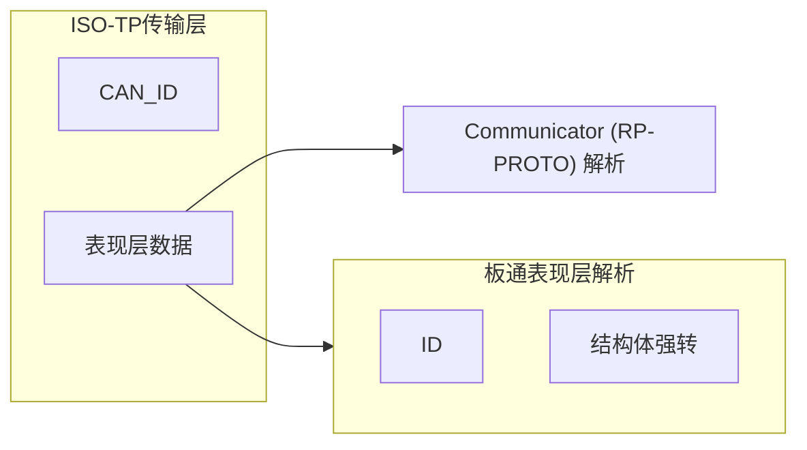

# Breeze B2B

吊射英雄板间通信模块试行. 目前处于乱写状态, 后续会整理出框架到 `breeze-modules`.

## 通信结构和协议定义



## 抽象层次和结构

设计两层, 一层是板通协议基础设施, 一层是具体协议.

协议基础设施提供一个超大模板类, 把各种具体协议作为trait放进去.

```c++

template<typename ...Msg>
class Proto;
```

然后直接提供 `Encode` / `Decode` 方法. Id细节会自动根据 `...Msg` 的顺序生成.

```c++
template<typename TMsg>
void Encode(const TMsg msg, std::span<std::byte> buffer);

template<typename TMsg>
void Decode(const TMsg msg, std::span<std::byte> buffer);
```
